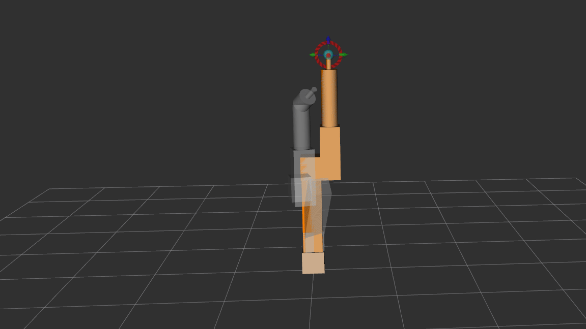

# 6-DOF Manipulator 3D Trajectory Drawing with ROS 2 & MoveIt 2

A ROS 2 and MoveIt 2 project demonstrating 3D path planning, Gazebo physics simulation, and real-time end-effector trail visualization in RViz. The manipulator executes a sequence of spatial waypoints to write out **"LEN"** in mid-air while dynamically toggling trail rendering between letters.

## Demonstration



---

## Task Overview

This project integrates a custom 6-DOF robotic arm (`rob_manip`) with **MoveIt 2** and **Gazebo** via `gz_ros2_control`. Using the `pymoveit2` Python interface, the control node plans and executes trajectories across 3D space while synchronizing with a custom `tf2`-based visualization node that renders the end-effector's path in RViz using `visualization_msgs/msg/MarkerArray`.

---

## System Architecture

The workspace is structured around two core execution nodes launched alongside the simulation and MoveIt 2 pipeline:

### 1. `robot_drawer` (`robot_drawer.py`)
* Interfaces with the `arm` planning group (`joint_1` through `joint_6`, with `link_6` as the end-effector).
* Publishes a boolean state to `/draw_enable` (`std_msgs/msg/Bool`) to act as a virtual pen-up / pen-down trigger.
* Executes the spatial waypoint sequence to trace the characters **L**, **E**, and **N**, and returns the manipulator to its zeroed home configuration (`[0.0, 0.0, 0.0, 0.0, 0.0, 0.0]`) upon completion.

### 2. `path_visualizer` (`path_visualizer.py`)
* Subscribes to `/draw_enable` to segment active drawing strokes from non-drawing travel moves.
* Queries the `tf2` tree for the `world` to `link_6` transform every $0.1\text{ s}$ while drawing is enabled.
* Publishes accumulated stroke segments as a `visualization_msgs/msg/MarkerArray` on the `/robot_path` topic for live rendering in RViz.

### 3. `rob_manip.launch.xml`
* Launches the Robot State Publisher, Gazebo (`empty.sdf`), and `ros_gz_bridge` (bridging `/clock`).
* Starts `move_group` and RViz, spawns the `ros2_control` controllers, starts `path_visualizer`, and triggers `robot_drawer` after a $5.0\text{ s}$ initialization timer.

---

## Build the Workspace

Ensure you have **ROS 2** (e.g., Jazzy/Humble), **MoveIt 2**, **Gazebo (`ros_gz_sim`)**, and **`pymoveit2`** installed in your workspace.

 Build the workspace and source the overlay:
   ```bash
   cd ~/ros2_ws
   colcon build
   source install/setup.bash
   ```

---

## Usage Instructions

Launch the entire simulation, MoveIt 2 planning pipeline, RViz visualization, and drawing sequence with a single command:

```bash
source install/setup.bash
ros2 launch rob_manip_bringup rob_manip.launch.xml
```

Once launched:
1. Gazebo and RViz will open and initialize the `arm_controller`.
2. After a 5-second delay, the `robot_drawer` node will automatically begin moving the manipulator to trace **"LEN"** in the `YZ` plane.
3. Ensure the **MarkerArray** display in RViz is subscribed to `/robot_path` to view the rendered 3D trail.